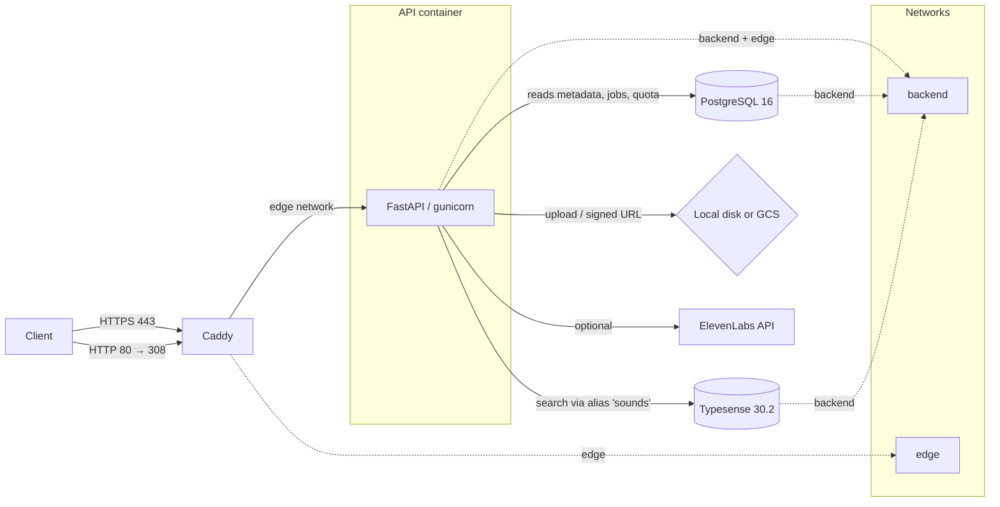

# Architecture

## Components

- **Caddy 2.9** terminates TLS (automatic HTTPS with ACME) and reverse-proxies `/` to the API. Only Caddy publishes ports in production.
- **FastAPI (Python 3.12, 4 gunicorn/uvicorn workers)** serves `/health`, `/search`, `/sounds/...` and `/generate`.
- **PostgreSQL 16** is the source of truth: sound metadata, generation jobs, quotas and `indexed_at`.
- **Typesense 30.2** is a derived search index. The API only queries the `sounds` alias, which points at `sounds_v1` (keyword) or `sounds_v2` (keyword + auto-embeddings).
- **Storage** is behind a `Storage` interface: `local` (HMAC-signed URLs served by the API) or `gcs` (V4 signed URLs via IAM `signBlob`).
- **Generation** is behind a `SoundGenerator` interface: `mock` (bundled mp3) or `elevenlabs` (`POST /v1/sound-generation`, with a narrow fallback to mock on 401/402/403).

## Write path (generation)

1. `POST /generate` takes an advisory lock keyed by `sha256(prompt.strip())`.
2. If a sound with that `prompt_hash` exists, return it — no provider call, no quota consumed.
3. Check the rolling 24-hour quota in `generation_jobs` (all attempts count).
4. Insert `generation_jobs(status='pending')`, generate audio, upload it to `Storage`.
5. Insert the sound into Postgres and mark the job `done` in one transaction.
6. Upsert the document into the active Typesense alias. On success set `indexed_at`; on failure leave it NULL. `scripts/reindex.py --only-unindexed` repairs later.

Postgres can therefore be consistent while the derived index is briefly behind; `indexed_at` is a minimal outbox marker, not a queue.

## Search path

- `GET /search?mode=keyword`: `query_by=title,tags,description` with weights `3,2,1`, facets on `category/format/tags/source`, duration range filters, sort by relevance then date.
- `GET /search?mode=hybrid`: `query_by=embedding,title,tags,description` with weights `1,3,2,1` and `vector_query=embedding:([], k:100)`. The embedding is generated inside Typesense from `title + description` with `ts/all-MiniLM-L12-v2` (384 dims, cosine).
- `suggest_generate` is true when fewer than 3 hits are found; the UI/API client can then call `/generate`.

## Index versioning and deploys

`scripts/reindex.py --collection sounds_v2 --with-embeddings` builds a new collection from Postgres. `--only-alias` flips `sounds` to it with one atomic upsert, so readers never see a partially built index and the old collection remains available for instant rollback.

## Networks and volumes

- `backend`: API ↔ Postgres ↔ Typesense (no host ports in production).
- `edge`: Caddy ↔ API.
- Named volumes: `pgdata`, `tsdata`, `audio`, `caddy_data`, `caddy_config`. In dev the override binds db/Typesense/API to `127.0.0.1` only and hot-reloads the API source.
